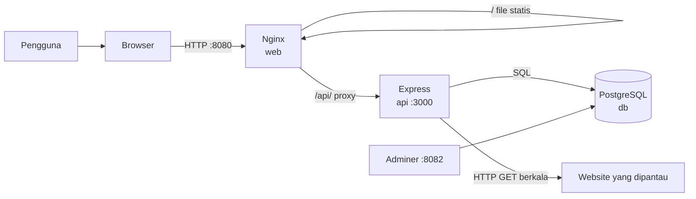
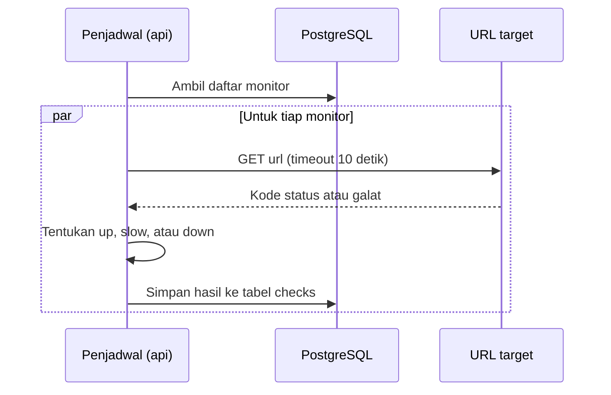
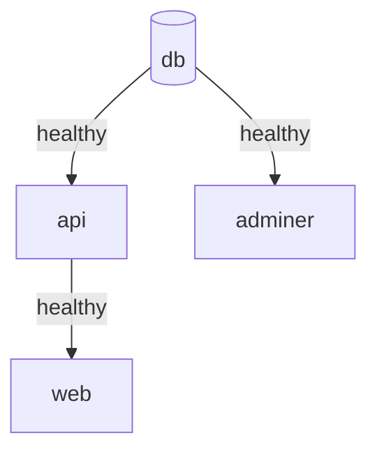
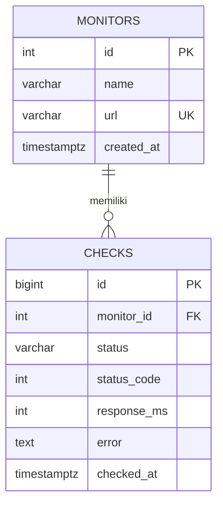
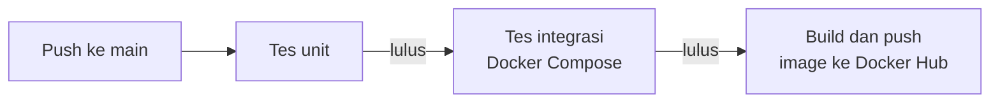

# Uptime Monitor: Pemantau Ketersediaan Website


> Aplikasi web untuk memantau ketersediaan website dan API secara otomatis. Dibangun dengan Node.js (Express), PostgreSQL, dan Nginx, dijalankan sebagai beberapa container dengan Docker Compose, dan dikirim ke Docker Hub lewat pipeline CI/CD GitHub Actions.

## Daftar Isi

1. [Ringkasan Proyek](#1-ringkasan-proyek)
2. [Latar Belakang Masalah](#2-latar-belakang-masalah)
3. [Pengguna Sasaran](#3-pengguna-sasaran)
4. [Fitur Utama](#4-fitur-utama)
5. [Batasan dan Rencana Pengembangan](#5-batasan-dan-rencana-pengembangan)
6. [Ruang Lingkup Aplikasi](#6-ruang-lingkup-aplikasi)
7. [Arsitektur Sistem](#7-arsitektur-sistem)
8. [Teknologi yang Digunakan](#8-teknologi-yang-digunakan)
9. [Desain Database](#9-desain-database)
10. [Kebutuhan API](#10-kebutuhan-api)
11. [Rencana Docker dan Kontainerisasi](#11-rencana-docker-dan-kontainerisasi)
12. [Konfigurasi Lingkungan](#12-konfigurasi-lingkungan)
13. [Pipeline CI/CD](#13-pipeline-cicd)
14. [Rencana Pengujian](#14-rencana-pengujian)
15. [Pengembang dan Referensi](#15-pengembang-dan-referensi)

---

## 1. Ringkasan Proyek

**Uptime Monitor** memeriksa apakah sebuah website atau layanan masih aktif. Pengguna mendaftarkan nama dan URL yang ingin dipantau. Sistem lalu mengirim permintaan HTTP ke URL tersebut secara berkala, mencatat status dan waktu responsnya, lalu menampilkannya di dashboard.

### Tujuan utama

- Memantau banyak URL secara otomatis tanpa perlu dicek manual.
- Menampilkan status terkini, waktu respons, dan persentase uptime 30 hari.
- Menampilkan riwayat 40 pengecekan terakhir dan insiden terbaru.
- Menjalankan seluruh komponen secara konsisten dengan Docker Compose.
- Mengotomatiskan tes, build, dan pengiriman image lewat GitHub Actions.

### Ringkasan teknis

| Area | Implementasi |
|---|---|
| Nama aplikasi | Uptime Monitor |
| Frontend | HTML, CSS, dan JavaScript tanpa framework, disajikan Nginx |
| Backend | Node.js 22 dan Express 5 |
| Database | PostgreSQL 16 |
| Administrasi database | Adminer |
| Orkestrasi lokal | Docker Compose (4 container) |
| CI/CD | GitHub Actions, image dikirim ke Docker Hub |
| Pengujian | Test runner bawaan Node.js (`node --test`) |

---

## 2. Latar Belakang Masalah

Pemilik website sering baru mengetahui layanannya mati setelah ada pengguna yang melapor. Pengecekan manual tidak efisien, dan riwayat kegagalan sulit dilacak.

| Masalah | Dukungan Uptime Monitor |
|---|---|
| Tidak tahu kapan layanan mati | Pengecekan otomatis berkala |
| Layanan hidup tetapi lambat | Status `slow` bila respons di atas 1.000 ms |
| Sulit melihat tren | Batang riwayat dan uptime 30 hari |
| Sulit mengetahui kapan masalah mulai | Daftar insiden saat status berubah |

Aplikasi ini adalah pemantau sederhana. Aplikasi **bukan** pengganti layanan monitoring profesional.

---

## 3. Pengguna Sasaran

| Kelompok | Kebutuhan |
|---|---|
| Pemilik website kecil atau UMKM | Mengetahui bila situs mati |
| Developer dan mahasiswa | Memantau API atau proyek pribadi |
| Tim kecil | Satu dashboard status untuk beberapa layanan |

---

## 4. Fitur Utama

### 4.1 Pengecekan otomatis

Penjadwal di dalam API mengecek semua monitor secara paralel pada interval tertentu (default 60 detik, minimum 10 detik).

| Hasil pengecekan | Status |
|---|---|
| Kode status di bawah 400 dan respons maksimal 1.000 ms | `up` (Aktif) |
| Kode status di bawah 400 tetapi respons di atas 1.000 ms | `slow` (Lambat) |
| Kode status 400 ke atas, timeout (10 detik), atau galat jaringan | `down` (Gangguan) |

### 4.2 Dashboard

- Banner peringatan bila ada layanan yang tidak dapat dijangkau.
- Empat kartu ringkasan: total monitor, aktif, perlu perhatian, dan uptime 30 hari.
- Daftar monitor dengan status, waktu respons, uptime 30 hari, dan 40 batang riwayat.
- Halaman menyegarkan diri tiap 15 detik.

### 4.3 Kelola monitor

- Tambah monitor (nama dan URL). Monitor baru langsung dicek tanpa menunggu putaran berikutnya.
- Hapus monitor beserta seluruh riwayatnya.
- Validasi input: nama 2 sampai 100 karakter, URL harus diawali `http://` atau `https://`, URL tidak boleh duplikat.

### 4.4 Insiden terbaru

Insiden dicatat saat status sebuah monitor **berubah** menjadi `slow` atau `down` (7 hari terakhir, maksimal 10 entri).

### 4.5 Uptime 30 hari

Uptime dihitung sebagai persentase pengecekan yang tidak berstatus `down` dalam 30 hari terakhir.

---

## 5. Batasan dan Rencana Pengembangan

Fitur di bawah ini **belum tersedia**.

| Fitur | Status | Catatan |
|---|---|---|
| Login dan multi-pengguna | Belum ada | Semua pengunjung melihat dan mengelola monitor yang sama |
| Notifikasi (email, Telegram) | Belum ada | Status hanya terlihat di dashboard |
| Grafik waktu respons | Belum ada | Baru berupa batang riwayat status |
| Deploy ke hosting publik | Belum ada | Pipeline berhenti di pengiriman image ke Docker Hub |
| Pembatasan URL internal | Belum ada | Lihat catatan keamanan di bagian 14 |

---

## 6. Ruang Lingkup Aplikasi

### Termasuk

- Dashboard web, REST API, dan penjadwal pengecekan.
- Penyimpanan monitor dan riwayat di PostgreSQL.
- Docker Compose untuk web, API, database, dan Adminer.
- Pipeline CI/CD dengan tes unit, tes integrasi, dan pengiriman image.

### Tidak termasuk

- Autentikasi pengguna dan pembagian hak akses.
- Pengiriman notifikasi.
- Infrastruktur cloud atau hosting produksi.

---

## 7. Arsitektur Sistem

### 7.1 Alur komponen



### 7.2 Alur pengecekan



### 7.3 Urutan start container



Browser hanya berbicara ke Nginx. Nginx meneruskan permintaan `/api/` ke container `api` lewat jaringan internal Compose, sehingga frontend tidak perlu mengetahui alamat API dan tidak ada masalah CORS.

---

## 8. Teknologi yang Digunakan

### Frontend

| Teknologi | Pemakaian |
|---|---|
| HTML, CSS, JavaScript | Antarmuka dashboard |
| Nginx 1.27 (Alpine) | Menyajikan file statis dan reverse proxy `/api/` |

### Backend

| Teknologi | Pemakaian |
|---|---|
| Node.js 22 (Alpine) | Runtime |
| Express 5 | Routing REST API |
| `pg` (node-postgres) | Koneksi dan query PostgreSQL |
| `node:test` | Test runner bawaan Node.js |

### Data dan infrastruktur

| Teknologi | Pemakaian |
|---|---|
| PostgreSQL 16 (Alpine) | Penyimpanan monitor dan riwayat |
| Adminer | Antarmuka administrasi database untuk lingkungan lokal |
| Docker dan Docker Compose | Kontainerisasi dan orkestrasi |
| GitHub Actions | CI/CD |
| Docker Hub | Penyimpanan image |

---

## 9. Desain Database

Database `uptime_db` memiliki dua tabel. Skemanya ada di `db/init.sql` dan dijalankan otomatis saat database pertama kali dibuat.



### Tabel `monitors`

| Kolom | Tipe | Aturan |
|---|---|---|
| `id` | `SERIAL` | Primary key |
| `name` | `VARCHAR(100)` | Wajib |
| `url` | `VARCHAR(500)` | Wajib, unik |
| `created_at` | `TIMESTAMPTZ` | Default waktu saat dibuat |

### Tabel `checks`

| Kolom | Tipe | Aturan |
|---|---|---|
| `id` | `BIGSERIAL` | Primary key |
| `monitor_id` | `INT` | Foreign key ke `monitors.id`, `ON DELETE CASCADE` |
| `status` | `VARCHAR(10)` | Hanya `up`, `slow`, atau `down` |
| `status_code` | `INT` | Kode HTTP, kosong bila gagal terhubung |
| `response_ms` | `INT` | Waktu respons dalam milidetik |
| `error` | `TEXT` | Pesan galat bila ada |
| `checked_at` | `TIMESTAMPTZ` | Default waktu saat dicatat |

Indeks `idx_checks_monitor_time (monitor_id, checked_at DESC)` mempercepat pengambilan riwayat terbaru.

### Persistensi data

- Data PostgreSQL disimpan di volume Docker bernama `pgdata`, sehingga tidak hilang saat container dimatikan.
- Skrip `init.sql` hanya dijalankan saat direktori data masih kosong. Perubahan skema tidak diterapkan otomatis ke volume yang sudah terisi.
- Riwayat pengecekan lebih dari 31 hari dihapus otomatis oleh penjadwal.
- `docker compose down -v` menghapus volume beserta seluruh data.

---

## 10. Kebutuhan API

Alamat dasar dari komputer lokal: `http://localhost:3001` (langsung) atau `http://localhost:8080/api` (lewat Nginx).

| Method | Endpoint | Keterangan |
|---|---|---|
| `GET` | `/api/health` | Pemeriksaan kesehatan, juga mengetes koneksi database |
| `GET` | `/api/monitors` | Daftar monitor dengan status terakhir, uptime 30 hari, dan riwayat |
| `POST` | `/api/monitors` | Tambah monitor |
| `DELETE` | `/api/monitors/{id}` | Hapus monitor |
| `GET` | `/api/incidents` | Insiden terbaru |

Contoh menambah monitor:

```json
{
  "name": "Situs Utama",
  "url": "https://example.com"
}
```

### Respons dan galat

| Situasi | Respons |
|---|---|
| Input tidak valid | `400 Bad Request` dengan daftar `errors` |
| URL sudah dipantau | `409 Conflict` |
| Monitor berhasil dibuat | `201 Created` |
| Monitor berhasil dihapus | `204 No Content` |
| ID tidak valid | `400 Bad Request` |
| Monitor tidak ditemukan | `404 Not Found` |
| Database tidak terjangkau saat health check | `503 Service Unavailable` |

---

## 11. Rencana Docker dan Kontainerisasi

| Service | Container | Port host | Fungsi |
|---|---|---:|---|
| `db` | `uptime_db` | tidak dibuka | PostgreSQL |
| `api` | `uptime_api` | `3001` | Express dan penjadwal |
| `web` | `uptime_web` | `8080` | Nginx dan dashboard |
| `adminer` | `uptime_adminer` | `8082` | Administrasi database |

Port container API tetap `3000`. Port host dipetakan ke `3001` agar tidak bentrok dengan program lain di komputer pengembang.

### Praktik yang diterapkan

- **Health check** pada `db` (`pg_isready`) dan `api` (`/api/health`). `depends_on` dengan `condition: service_healthy` memastikan urutan start yang benar.
- **Layer caching**: `package.json` disalin dan `npm ci` dijalankan sebelum kode disalin.
- **`npm ci --omit=dev`**: dependensi persis sesuai `package-lock.json`, tanpa paket pengembangan.
- **`USER node`**: API berjalan tanpa hak root.
- **`.dockerignore`**: `node_modules` dan file tes tidak masuk image.
- **Kredensial lewat `.env`**: tidak ada password di `docker-compose.yml` maupun repository.
- **`restart: unless-stopped`** pada semua service.

### Menjalankan aplikasi

Prasyarat: Docker Desktop (atau Docker Engine dengan Compose).

```bash
git clone https://github.com/ride016/uptime-monitor.git
cd uptime-monitor
cp .env.example .env        # Windows PowerShell: Copy-Item .env.example .env
# edit .env dan ganti POSTGRES_PASSWORD
docker compose up --build -d
docker compose ps
```

| Aplikasi | Alamat |
|---|---|
| Dashboard | <http://localhost:8080> |
| API health check | <http://localhost:3001/api/health> |
| Adminer | <http://localhost:8082> |

Pengecekan pertama muncul sekitar satu menit setelah aplikasi menyala.

### Perintah umum

```bash
docker compose ps                 # status container
docker compose logs -f api        # log API
docker compose down               # hentikan, data tetap ada
docker compose down -v            # hentikan dan HAPUS data database
```

### Menjalankan dari image Docker Hub

Image hasil pipeline tersedia di:

- `ride016/uptime-monitor-api`
- `ride016/uptime-monitor-web`

```bash
docker pull ride016/uptime-monitor-api:latest
docker pull ride016/uptime-monitor-web:latest
```

---

## 12. Konfigurasi Lingkungan

### 12.1 File `.env`

Salin `.env.example` menjadi `.env` di folder yang sama dengan `docker-compose.yml`, lalu ganti password contoh. File `.env` sudah dimasukkan ke `.gitignore`. Jangan menaruh password asli di `.env.example`, README, atau kode.

| Variabel | Fungsi | Contoh di `.env.example` |
|---|---|---|
| `POSTGRES_USER` | Pengguna PostgreSQL | `uptime` |
| `POSTGRES_PASSWORD` | Password PostgreSQL | `ganti_dengan_password_kuat` |
| `POSTGRES_DB` | Nama database | `uptime_db` |
| `CHECK_INTERVAL_SECONDS` | Interval pengecekan (minimum 10) | `60` |

### 12.2 Variabel di container API

Diatur oleh `docker-compose.yml`, nilainya berasal dari `.env`.

| Variabel | Fungsi |
|---|---|
| `PORT` | Port server di dalam container (`3000`) |
| `DB_HOST` | Nama service database (`db`) |
| `DB_PORT` | Port PostgreSQL (`5432`) |
| `DB_USER`, `DB_PASSWORD`, `DB_NAME` | Kredensial dan nama database |
| `CHECK_INTERVAL_SECONDS` | Interval pengecekan |

### 12.3 Jaringan

- Antar-container berkomunikasi memakai nama service (`db`, `api`).
- Database tidak dibuka ke host, hanya dapat diakses dari jaringan Compose dan lewat Adminer.

---

## 13. Pipeline CI/CD

Pipeline ada di `.github/workflows/ci-cd.yml` dan berjalan pada setiap `push` dan `pull request` ke branch `main`.



| Tahap | Isi | Berjalan pada |
|---|---|---|
| Tes unit | `npm ci` dan `npm test` di Node.js 22 | Push dan pull request |
| Tes integrasi | Menyalakan seluruh Compose di mesin GitHub, lalu memeriksa `/api/health`, `/api/monitors`, dan halaman web lewat Nginx | Push dan pull request |
| Kirim image | Build image API dan web, lalu push ke Docker Hub dengan tag `latest` dan kode commit | Hanya push ke `main` |

Tahap berikutnya hanya berjalan bila tahap sebelumnya lulus.

### Secrets

Kredensial Docker Hub disimpan di GitHub Secrets dan tidak pernah tertulis di kode:

| Secret | Isi |
|---|---|
| `DOCKERHUB_USERNAME` | Username Docker Hub |
| `DOCKERHUB_TOKEN` | Personal access token Docker Hub (Read dan Write) |

---

## 14. Rencana Pengujian

### 14.1 Pengujian otomatis

Dijalankan dengan `npm test` di folder `api`. Tes memakai database tiruan, jadi tidak membutuhkan PostgreSQL.

| Berkas tes | Cakupan | Jumlah |
|---|---|---:|
| `checker.test.js` | Klasifikasi status, server sehat, balasan 500, timeout, host tidak ada | 10 |
| `validate.test.js` | Validasi nama dan URL | 5 |
| `app.test.js` | Health check, tambah dan hapus monitor, kode 400, 404, 409 | 8 |
| `scheduler.test.js` | Pengecekan semua monitor, kegagalan terisolasi, putaran tumpang tindih | 3 |

Hasil: **26 tes lulus, 0 gagal**.

### 14.2 Pengujian manual

| Skenario | Kriteria lulus |
|---|---|
| Buka dashboard | Monitor tampil dengan status dan riwayat |
| Tambah monitor valid | Monitor muncul dan langsung dicek |
| Tambah URL tanpa `https://` | Pesan galat tampil di formulir |
| Tambah URL yang sudah ada | Ditolak dengan pesan URL sudah dipantau |
| Monitor ke URL yang tidak ada | Berstatus Gangguan dan tercatat di insiden |
| Hapus monitor | Monitor dan riwayatnya hilang |
| `docker compose down` lalu `up` | Data tetap ada |

### 14.3 Pengujian container

- Keempat container berstatus `Up`, dan `db`, `api` bertanda `healthy`.
- Dashboard dapat dibuka di `http://localhost:8080`.
- Tabel `monitors` dan `checks` terlihat di Adminer.

### 14.4 Catatan keamanan

- API belum memiliki autentikasi, jadi sebaiknya tidak dibuka ke internet publik.
- Aplikasi menerima URL `http`/`https` apa pun, termasuk alamat jaringan internal. Pada penggunaan publik, batasi alamat yang boleh dipantau.
- Port Adminer dan API hanya untuk lingkungan lokal.

---

## 15. Pengembang dan Referensi

### Pengembang

| Nama | Peran |
|---|---|
| Ari Wirawan Nst (Ride) | Perancangan, backend, frontend, containerisasi, CI/CD, dan dokumentasi |

### Struktur repository

```text
uptime-monitor/
├── api/                 Express, penjadwal, tes, Dockerfile
├── web/                 Dashboard, konfigurasi Nginx, Dockerfile
├── db/                  init.sql (skema dan data awal)
├── .github/workflows/   Pipeline CI/CD
├── docker-compose.yml
├── .env.example
└── README.md
```

### Referensi

- Dokumentasi Express, Node.js, PostgreSQL, dan Nginx
- Dokumentasi Docker dan Docker Compose
- Dokumentasi GitHub Actions
- Image resmi `node`, `nginx`, `postgres`, dan `adminer` di Docker Hub
- Aplikasi ini dikembangkan dengan bantuan AI (Claude) dalam perancangan dan penulisan kode.

### Dokumentasi video

| Video | Tautan |
|---|---|
| Implementasi aplikasi dalam container | [isi tautan video] |
| Penjelasan implementasi CI/CD | [isi tautan video] |
